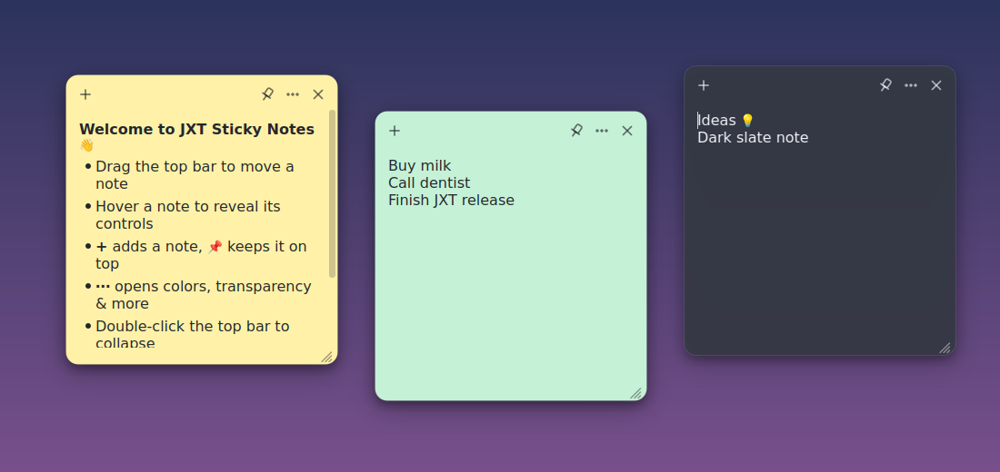
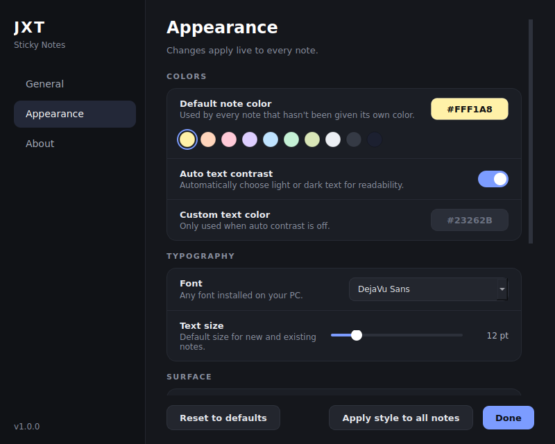

<div align="center">


# JXT Sticky Notes

**A clean, classy and fully customizable sticky notes app for Windows.**
Lives in your system tray, starts with Windows, and stays out of your way.

[](LICENSE)




</div>

---

## Features

- **Auto-start with Windows** and **start minimized to the system tray**
- **Unlimited notes**: frameless, draggable, resizable
- **Always on top**: globally, or pin individual notes
- **Full customization** from a dedicated settings window (live preview):
  - Note colors: 10 curated presets plus any custom color
  - Auto text contrast or your own text color
  - Any installed font, adjustable text size
  - Note opacity (frosted glass look), corner roundness, drop shadow
  - Default size for new notes
- **Per-note overrides**: color, transparency, text size, always-on-top
- **Minimal by design**: controls only appear when you hover a note
- **Collapse** a note to its title bar with a double-click
- **Light formatting**: bold, italic, strikethrough, bullet lists
- **Autosave**: your notes and positions are restored exactly as you left them
- **Single instance**: launching it again simply brings your notes forward
- **Private**: everything is stored locally. No accounts, no network, no telemetry

<div align="center">

</div>

## Download

Grab the latest `JXT-Sticky-Notes.exe` from the [**Releases**](../../releases) page and run it. No installer and no admin rights needed.

> **Note:** the exe is not code-signed, so Windows SmartScreen may show a warning the first time.
> Click **More info → Run anyway**, or build it yourself from source (below).

## Using it

| Action | How |
| --- | --- |
| New note | `+` on a note, `Ctrl+N`, or the tray menu |
| Move a note | Drag its top bar |
| Resize | Drag the bottom-right corner |
| Colors, transparency, text size, duplicate, delete | `⋯` menu on a note |
| Keep a note on top | 📌 button on the note |
| Collapse / expand | Double-click the top bar |
| Show / hide all notes | Click the tray icon |
| Settings | Tray icon → **Settings…** |
| Bold / italic | `Ctrl+B` / `Ctrl+I` |
| Strikethrough | `Ctrl+Shift+X` |
| Bullet list | `Ctrl+Shift+L` |

**Start with Windows** is turned on the first time you run the app. To turn it off, open **Settings → General** (or right-click the tray icon). It uses the per-user registry `Run` key, so uninstalling is as simple as switching it off and deleting the exe.

## Run from source

Requires Python 3.10+ on Windows.

```bash
git clone https://github.com/jxtsidhu/JXT-Sticky-Notes.git
cd JXT-Sticky-Notes
python -m pip install -r requirements.txt
python main.py
```

## Build the exe yourself

```bat
build.bat
```

This installs the build tools, generates the icon and produces `dist\JXT-Sticky-Notes.exe` using PyInstaller.

## Where is my data?

Notes and settings are stored as plain JSON in `%APPDATA%\JXTStickyNotes\`
(`notes.json` and `settings.json`). **Settings → About → Open data folder** takes you there. Copy the folder to back up or move your notes.

## Project structure

```
main.py             entry point
app.py              controller, tray icon, single-instance logic
note_window.py      the sticky note window
settings_dialog.py  customization UI
widgets.py          custom-painted controls
themes.py           palette, styles, app icon
autostart.py        start-with-Windows (registry)
config.py           settings + paths
make_icon.py        generates icon.png and icon.ico
build.bat           builds the exe
```

## Contributing

Issues and pull requests are welcome. Ideas on the wishlist: global hotkey for a new note, checklists, note search, import/export, and theme packs.

## License

Released under the [MIT License](LICENSE). Copyright © 2026 Jxt Sidhu.
